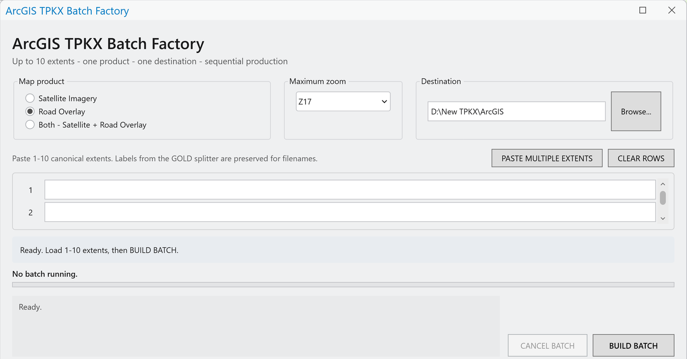
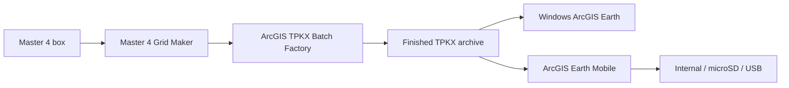

# ArcGIS Earth Offline Maps & Field Tracking

## Download the tools

### **⬇️ [DOWNLOAD ARCGIS TPKX BATCH FACTORY](downloads/TPKX_Batch_Factory_v1.zip)**
**📖 [User manual](docs/TPKX_BATCH_FACTORY.md)**

ArcGIS Pro add-in that turns controlled extents into Satellite, Road Overlay, or Both TPKX packages at Z16-Z20. The extents come from the [Master 4 Grid Maker](https://github.com/Jim-dc95811/QGIS-Mbtile-to-ArcGIS-Earth-TPKX/blob/main/MASTER4_GRID_MAKER.md).



*The Batch Factory inside ArcGIS Pro: pick the map product, maximum zoom and destination, paste up to 10 extents, then BUILD BATCH.*

### **⬇️ [DOWNLOAD PRAVE / ME TRACKER v1.2](downloads/PRAVE_ME_Tracker_v1.zip)**
**📖 [User manual](docs/PRAVE_ME_TRACKER.md)**

Track ME and remote PRAVE units directly in ArcGIS Earth through the local Automation API. v1.1 fixed the launchers and keeps units on the map through a serial reconnect; v1.2 keeps a Windows proxy setting from blocking the connection to ArcGIS Earth ([changes](docs/PRAVE_ME_TRACKER_V1.1_CHANGES.md)).

### **⬇️ [DOWNLOAD PRAVE / RMC FIELD DECODER TESTER v1.0 GOLD](downloads/PRAVE_RMC_Field_Decoder_Tester_v1_0_Gold.zip)**
**📖 [User manual (PDF)](docs/PRAVE_RMC_Field_Decoder_Tester_v1_0_Gold_Instructions.pdf)**

Bench-test the tracker without a radio: a simulated Raveon RMC/PRAVE stream with six units covering every RSSI icon ([bench-test guide](docs/PRAVE_ME_TRACKER.md#bench-testing-without-a-radio)).

> **ArcGIS Earth Unlocked:** this repository is the earlier offline-map/chartplotting/field-tracker branch of the broader project family. See the [master system map](https://github.com/Jim-dc95811/ArcGIS-Earth-Unlocked) and the [ArcGIS Earth Object Factory](https://github.com/Jim-dc95811/ArcGIS-Earth-Object-Factory).

> **Build high-detail maps once. Carry them offline. Keep the field display useful when the network is gone.**

This repository packages a practical offline-map workflow around **ArcGIS Pro**, **TPKX tile packages**, **ArcGIS Earth**, and an optional **PRAVE / ME live field tracker**.

The project has moved well past a one-machine proof of concept. A **300+ GB district-wide Z20 archive** has been built and exercised across Windows desktops/laptops, Android phones/tablets, and an Amazon Fire tablet. On Android, TPKX files have also been opened from internal storage, microSD, and exFAT USB media.

[](https://www.youtube.com/watch?v=xPA3QfAW4aY)

*Pre-loaded ArcGIS Earth imagery for field use when the network is gone.*

## The tools

| Tool | Job |
|---|---|
| **ArcGIS TPKX Batch Factory** | ArcGIS Pro add-in that turns 1-10 controlled extents into Satellite, Road Overlay, or Both TPKX packages at Z16-Z20. |
| **PRAVE / ME Tracker** | Reads mixed RMC/PRAVE serial data and draws/tracks ME and remote units directly in ArcGIS Earth through the local Automation API. |
| **PRAVE / RMC Field Decoder Tester** | Simulated radio stream for trying the tracker on the bench. |

The production extents come from the **[Master 4 Grid Maker](https://github.com/Jim-dc95811/QGIS-Mbtile-to-ArcGIS-Earth-TPKX/blob/main/MASTER4_GRID_MAKER.md)**, which replaced the earlier TPKX Extent Tool.

## Start here

1. Read the [end-to-end workflow](docs/WORKFLOW.md).
2. Make your production extents with the [Master 4 Grid Maker](https://github.com/Jim-dc95811/QGIS-Mbtile-to-ArcGIS-Earth-TPKX/blob/main/MASTER4_GRID_MAKER.md).
3. Produce TPKX files with the [Batch Factory operator guide](docs/TPKX_BATCH_FACTORY.md).
4. Review the [mobile offline field notes](docs/MOBILE_OFFLINE.md).
5. If you use Raveon PRAVE/RMC data, see the [PRAVE / ME Tracker guide](docs/PRAVE_ME_TRACKER.md). To try it without a radio, use the [PRAVE / RMC Field Decoder Tester](docs/PRAVE_ME_TRACKER.md#bench-testing-without-a-radio).

## Watch the project

| | |
|---|---|
| [](https://www.youtube.com/watch?v=xPA3QfAW4aY)<br>**Pre-Loaded Satellite Maps for First Responders** | [](https://www.youtube.com/watch?v=uL69NTVnafE)<br>**Transforming an Android Phone into an ArcGIS Earth Map Viewer** |
| [](https://www.youtube.com/watch?v=KGckjaOu0hY)<br>**TPKX Factory — Satellite Maps at Scale** | [](https://www.youtube.com/watch?v=JKWJmEIBP_I)<br>**ArcGIS Earth Offline Georeferenced Chart Plotting** |

These short videos show the project from the field-use side first: why pre-loaded imagery matters, how Android can become a dedicated offline ArcGIS Earth viewer, how the TPKX production workflow scales, and how ArcGIS Earth can also serve as an offline georeferenced chartplotter.

## Workflow

```text
  Master 4 box (1 degree)
          |
          v
  Master 4 Grid Maker
          |
          v
 100 cell extent rows
          |
          v
ArcGIS TPKX Batch Factory
          |
          v
     finished .tpkx
          |
     +----+--------------------+
     |                         |
 Windows ArcGIS Earth     ArcGIS Earth Mobile
                               |
                      internal / microSD / USB
```

The live tracker is optional and sits beside the offline imagery workflow:

```text
Raveon mixed serial -> RMC = ME -> ArcGIS Earth camera center
                    -> PRAVE    -> remote units + RSSI drawings
```



## Manuals

- [ArcGIS TPKX Batch Factory - Operator Guide](docs/TPKX_BATCH_FACTORY.md)
- [PRAVE / ME Tracker - Guide](docs/PRAVE_ME_TRACKER.md)
- [PRAVE / RMC Field Decoder Tester - Instructions (PDF)](docs/PRAVE_RMC_Field_Decoder_Tester_v1_0_Gold_Instructions.pdf)
- [Master 4 Grid Maker - Guide](https://github.com/Jim-dc95811/QGIS-Mbtile-to-ArcGIS-Earth-TPKX/blob/main/MASTER4_GRID_MAKER.md) (in the companion MBTiles/TPKX repository)

The Master 4 Grid Maker only makes extents; it does not download imagery. The Factory is the production engine that consumes those extent rows.

> **Pasting Master 4 rows into the Batch Factory:** delete the file name at the end of each row first. The Factory accepts `01 -9028010.7033,-9016878.7543,3503549.8435,3516410.3983 [EPSG:3857]` but rejects the same row with `W082W081N031N030-001-GHY-Z20.tpkx` still on the end.

## What is field-proven here

- District-wide Z20 offline imagery archive exceeding 300 GB.
- Windows desktop and laptop use.
- Android phone and tablet use.
- Amazon Fire tablet use.
- TPKX opened from Android internal storage, microSD, and exFAT USB storage.
- ArcGIS Earth desktop ME center-screen tracking through the local Automation API while preserving the operator's selected zoom.
- PRAVE unit plotting with unit labels and RSSI-driven icon states.

Project-tested behavior is described as such; it should not be read as a guarantee for every Android OEM, ArcGIS version, storage device, or radio configuration.

## Requirements at a glance

### Batch Factory
- Windows
- ArcGIS Pro
- .NET/ArcGIS Pro SDK build components used by the included installer
- Internet access **during production** to retrieve the selected tile service
- Sufficient local storage for high-detail TPKX output

### PRAVE / ME Tracker
- Windows
- ArcGIS Earth desktop
- ArcGIS Earth Automation API enabled
- Python 3 + `pyserial`
- RMC/PRAVE serial source

## Offline does not mean unlicensed

This repository contains workflow code and documentation, **not a redistributed imagery archive**. Users are responsible for the licensing, export permissions, and terms that apply to the map services/data they use to create TPKX packages.

## Licensing

- **Source code and software packages:** [MIT License](LICENSE)
- **Original documentation, diagrams, manuals, written project material, and original project screenshots:** [Creative Commons Attribution 4.0 International (CC BY 4.0)](LICENSE-DOCS)

Third-party software, imagery, basemaps, trademarks, logos, user-interface elements, and other third-party content retain their own licenses and rights. These project licenses do not relicense ArcGIS, ArcGIS Pro, ArcGIS Earth, Esri imagery or basemaps, or other third-party material.

## Official ArcGIS references

See [Official Esri References](docs/OFFICIAL_ESRI_LINKS.md) for the ArcGIS Earth Automation API, local-file support, and ArcGIS Pro offline tile-cache documentation.

## Project status

The tool ZIPs are cleaned project distributions built from the current field-tested packages supplied for this repository. Development/test-era names and cache files were removed where they were not operationally required. The downloadable ZIPs contain the program source and launch/build files; the repository front page stays intentionally uncluttered. The PRAVE / RMC Field Decoder Tester ZIP is the owner's Gold bench generator, published unmodified; its development activity log was left out. The earlier TPKX Extent Tool v2 was retired on 2026-11-01 in favor of the Master 4 system; its zip and guide remain in this repository's Git history.

---

**Independent project.** ArcGIS, ArcGIS Pro, and ArcGIS Earth are Esri products and trademarks. This repository is not an Esri product or official Esri distribution.